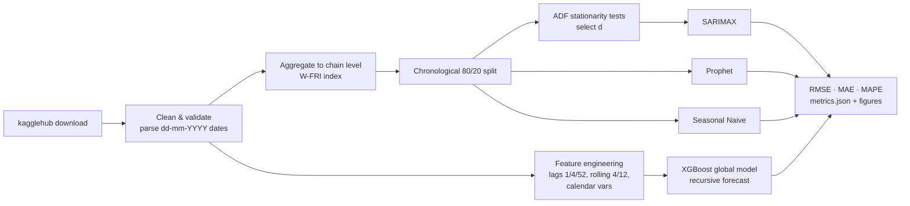
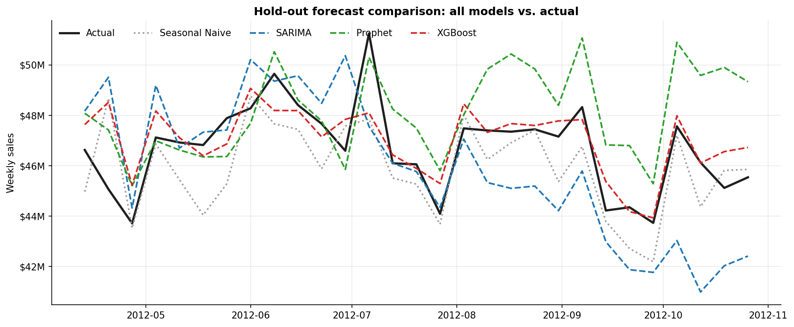
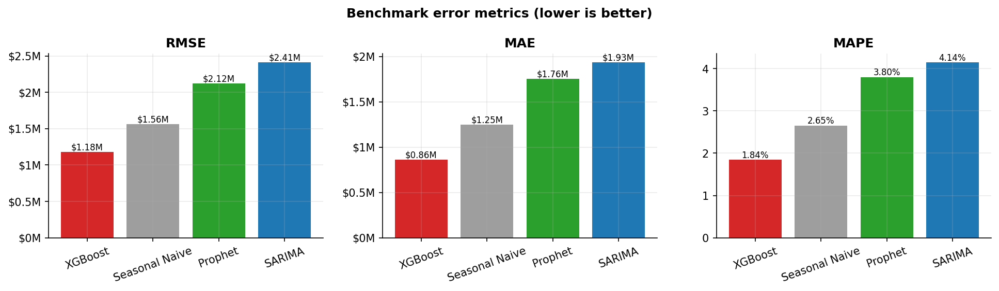

<div align="center">

# 🛒 Walmart Weekly Sales Forecasting Suite

**Statistical vs. Additive vs. Machine-Learning: a reproducible time series benchmark on 45 Walmart stores**


</div>

---

## Overview

This repository is an end-to-end forecasting pipeline for **weekly retail demand** (`Weekly_Sales`)
on the [Walmart Sales dataset](https://www.kaggle.com/datasets/mikhail1681/walmart-sales).
The data is fetched programmatically with `kagglehub`. The pipeline:

- runs a full **exploratory & stationarity analysis** (STL decomposition, ADF tests, ACF/PACF);
- engineers **leakage-safe supervised features** (lags `t-1`, `t-4`, `t-52`, past-only rolling statistics, calendar metadata);
- benchmarks three model families plus a seasonal-naive reference, **under one evaluation protocol**;
- writes a machine-readable benchmark (`outputs/metrics.json`), diagnostic figures, and refreshes the results table in this README.

One command reproduces everything:

```bash
python main.py
```

### Dataset at a glance

| Property | Value |
|---|---|
| Source | Kaggle, `mikhail1681/walmart-sales` (fetched via `kagglehub`) |
| Granularity | 45 stores × 143 weeks = 6,435 store-weeks |
| Period | 2010-02-05 → 2012-10-26 (weeks end on Friday) |
| Target | `Weekly_Sales` (USD) |
| Exogenous drivers | `Holiday_Flag`, `Temperature`, `Fuel_Price`, `CPI`, `Unemployment` |
| Benchmark target | Chain-level weekly sales (sum over all stores) |
| Split | Chronological 80 / 20, with no shuffling: ~114 train weeks, ~29 test weeks |

---

## Methodology Matrix

| Dimension | 📈 **SARIMA / SARIMAX** (Statistical) | 🌊 **Prophet** (Additive) | 🌲 **XGBoost** (Supervised ML) |
|---|---|---|---|
| **Paradigm** | Linear stochastic process (Box-Jenkins) | Bayesian curve-fitting: trend + seasonality + holidays | Gradient-boosted decision trees on tabular features |
| **Trend** | Differencing `d`, **picked automatically by ADF test** on training data | Piecewise-linear trend with automatic changepoint detection | Carried by `lag_*` and `roll_mean_*` (no `Year` feature, [see why](#model-selection-notes)) |
| **Seasonality** | Seasonal ARIMA terms, `m = 52`; seasonal differencing `D` from the OCSB test | Yearly (10 Fourier terms) + monthly (3 Fourier terms) | `lag_52`, `Week_of_Year`, `Month`, `Quarter` |
| **Holidays** | `Holiday_Flag` as exogenous regressor | Named US holidays (Super Bowl, Labor Day, Thanksgiving, Christmas) mapped to Walmart's week-ending-Friday grid, with a **pre-Christmas window** | `Holiday_Flag` feature + calendar interactions learned by trees |
| **Exogenous** | `CPI`, `Fuel_Price`, `Unemployment`, `Holiday_Flag` (z-scored on train) | `CPI`, `Fuel_Price`, `Unemployment` as additive regressors | `Holiday_Flag`, `Temperature` only. Trending covariates (`Year`, `CPI`, `Fuel_Price`, `Unemployment`) are **excluded** because trees can't extrapolate them ([why](#model-selection-notes)) |
| **Order / hyper-params** | `(p,q,P,Q)` by stepwise AIC search (`pmdarima.auto_arima`) | Prior scales on trend, seasonality and holidays | Early stopping on the last 12 training weeks, then refit on all training data |
| **Data used** | Chain-level series (114 points) | Chain-level series (114 points) | **All 45 store series** (≈5,100 rows): one global model, `Store` as a categorical feature |
| **Multi-step strategy** | Native h-step forecast | Native h-step forecast | **Recursive**: each prediction feeds the next step's lags and rolling stats |
| **Strengths** | Interpretable coefficients, prediction intervals, strong on short linear series | Handles holidays and changepoints gracefully; decomposable | Captures non-linear interactions; learns from every store |
| **Weaknesses** | Slow and fragile with `m = 52` on short histories; linear only | Can over-smooth sharp spikes; limited autoregressive memory | Error compounds in recursive forecasts; cannot extrapolate beyond the training range |

> **Seasonal Naive** (`ŷ(t) = y(t−52)`) is included as a sanity-check baseline. A model that
> can't beat "same week last year" isn't adding value.

### Pipeline



### Evaluation protocol (same for every model)

1. Fit on training weeks only. Every diagnostic, including ADF, scaling and early stopping, uses **training data only**.
2. Forecast the **entire 29-week hold-out in one pass** (multi-step ahead). No model ever sees a test-period sales value.
3. Exogenous drivers for the test weeks are treated as known (the usual *ex-post* setting; holidays are calendar facts).
4. Score the chain-level forecast with **RMSE**, **MAE** and **MAPE**.

### Leakage safeguards

- Lags use `shift(k ≥ 1)`. Rolling windows are computed on `shift(1)`, so week *t* only sees weeks *t−w … t−1*.
- All shifts and rolls run **within each store** (`groupby("Store")`), so nothing bleeds across series.
- The unit tests **tamper with future targets** and check that no past feature changes. They also corrupt the test targets and check that XGBoost's forecasts stay byte-identical.

---

## Performance Results

<!-- RESULTS:START -->
_Hold-out: **2012-04-13 → 2012-10-26** (29 weeks, multi-step ahead). Target: chain-level weekly sales (sum of 45 stores). Generated by `python main.py` on 2026-09-23._

| Rank | Model | RMSE ($) | MAE ($) | MAPE (%) |
|:---:|:---|---:|---:|---:|
| 1 | **XGBoost** | 1,181,279 | 860,966 | 1.84 |
| 2 | Seasonal Naive | 1,562,916 | 1,247,205 | 2.65 |
| 3 | Prophet | 2,123,723 | 1,755,419 | 3.80 |
| 4 | SARIMA | 2,410,576 | 1,934,629 | 4.14 |
<!-- RESULTS:END -->

### Key findings

- **XGBoost wins clearly: 1.84% MAPE**, about 30% lower MAE and MAPE than the seasonal-naive baseline, with
  almost no systematic bias (+0.7%). It's the only model that learns from all 45 store histories,
  and `lag_1`, `Store` and `roll_mean_4` provide over 85% of its gain. At the store level (summed
  over 45 × 29 store-weeks) its MAPE is 5.0%.
- **"Same week last year" is a hard baseline to beat.** Chain-level sales are stationary around a
  flat level (ADF on the level series: stat −5.27, p < 0.001, so `d = 0`), and the annual pattern
  repeats closely. Prophet (3.80%) and SARIMA (4.14%) both **lose** to Seasonal Naive (2.65%) on this window.
- **The two statistical models drift in opposite directions.** Prophet over-forecasts Aug–Oct 2012
  (+3.1% bias) as its trend and linear regressors extrapolate. SARIMAX under-forecasts late in the
  horizon (−1.6% bias) as its AR terms decay toward the regression mean.
- **Walmart's `Holiday_Flag` misses the real peaks.** Thanksgiving is flagged on its peak week,
  but the Christmas flag falls in the *post*-Christmas trough (see `00_sales_series_split.png`).
  Prophet's pre-Christmas holiday window is built to handle this.
- **Caveat:** the hold-out (Apr–Oct 2012) has no Q4 peak season, so these rankings describe
  mid-year accuracy. See [Limitations](#limitations--next-steps).

### Model selection notes

Settings were chosen on an **inner validation fold carved from the training data** (fit on the first
85 training weeks, validate on the next 29), never on the test window.

| Decision | Inner-fold MAPE | Outcome |
|---|---|---|
| XGBoost, all covariates incl. `Year`/`CPI`/`Fuel_Price`/`Unemployment` (first version) | 3.51% | replaced |
| XGBoost, per-store target scaling (÷ training mean) | 4.03% | kept as an option, off by default |
| **XGBoost, lags + calendar + `Holiday_Flag` + `Temperature` (no trending covariates)** | **3.29%** | **default** |
| Prophet with vs. without CPI/Fuel/Unemployment regressors | 3.86% vs. 3.84% | no real difference; kept as specified |
| SARIMAX with all four exogenous vars vs. `Holiday_Flag` only | 19.6% vs. 4.9% | kept as specified (see below) |

**Why XGBoost drops the trending covariates.** In the first version, XGBoost over-forecast the test
window by about 23%, and one-step-ahead forecasts (built from *actual* lags) were still about 10% too high.
The cause was extrapolation. Tree ensembles route any value beyond the training range into their
edge leaves, and during the test window `Fuel_Price` and `CPI` rise above, and `Unemployment` falls below,
anything seen in training. `Year = 2012` had only been seen with post-holiday Jan–Apr weeks.
Removing `Year` cut the one-step bias from +10.3% to +1.8%. Removing the macro levels too brought
it to +0.1%. That diagnosis used the test window to *find the bug*. The fix was confirmed on the
train-only inner fold above, where it also scored best.

**SARIMAX exogenous variables.** On the shorter inner-fold history, SARIMAX with all four exogenous
regressors was unstable (19.6% MAPE). With `Holiday_Flag` alone it scored 4.9%. The benchmark keeps
the originally specified SARIMAX (CPI, Fuel_Price, Unemployment, Holiday_Flag). To try the leaner
variant, use `SARIMAForecaster(exog_cols=("Holiday_Flag",))`.

### Visual diagnostics

After a run, `outputs/figures/` contains:

| Figure | What it shows |
|---|---|
| `00_sales_series_split.png` | Full chain-level series, flagged holiday weeks, and the train/test boundary |
| `01–04_actual_vs_pred_*.png` | Each model's forecast against actuals, with its metrics in the title |
| `10_model_comparison.png` | All forecasts overlaid on the hold-out window |
| `11_metrics_comparison.png` | RMSE / MAE / MAPE bar charts |
| `12_residuals.png` | Residuals over time (spots bias and drift) |
| `13_xgboost_feature_importance.png` | Gain-based feature importance |
| `14_prophet_components.png` | Prophet's trend, yearly, monthly, holiday and regressor components |

<p align="center">
  
</p>
<p align="center">
  
</p>

---

## Repository Structure

```text
walmart-sales-forecasting/
├── data/
│   ├── raw/                     # Walmart.csv copied here from the kagglehub cache
│   └── processed/               # cleaned store-level, weekly aggregate & feature tables
├── notebooks/
│   └── 01_walmart_sales_eda.ipynb   # EDA, STL decomposition, ADF, ACF/PACF, feature signal
├── src/
│   ├── __init__.py
│   ├── utils.py                 # run_adf_test, differencing search, metrics, plotting
│   ├── data_prep.py             # kagglehub ingestion, cleaning, aggregation, chronological split
│   ├── features.py              # calendar vars, lags, past-only rolling statistics
│   └── models.py                # SeasonalNaive / SARIMA / Prophet / XGBoost wrappers
├── tests/
│   ├── conftest.py              # offline synthetic fixture with the exact Kaggle schema
│   └── test_pipeline.py         # 38 pytest unit tests
├── outputs/
│   ├── figures/                 # evaluation plots
│   ├── metrics.json             # benchmark matrix + diagnostics
│   └── predictions.csv          # hold-out actuals and every model's forecast
├── main.py                      # CLI orchestrating the full pipeline
├── pytest.ini
├── requirements.txt
└── README.md
```

---

## How to Run

### 1. Set up the environment (Python 3.11 recommended)

```bash
git clone https://github.com/<HardikMalik14>/walmart-sales-forecasting.git
cd walmart-sales-forecasting

python -m venv .venv
# macOS / Linux
source .venv/bin/activate
# Windows (PowerShell)
.venv\Scripts\Activate.ps1

pip install -r requirements.txt
```

> `kagglehub` downloads public datasets without credentials. If Kaggle asks you to authenticate,
> run `python -c "import kagglehub; kagglehub.login()"` or set `KAGGLE_USERNAME` / `KAGGLE_KEY`.

### 2. Run the full pipeline

```bash
python main.py
```

It takes about 1–2 minutes; most of that is SARIMA's seasonal (`m=52`) order search.

Useful options:

```bash
python main.py --data-path path/to/Walmart.csv   # use a local CSV instead of downloading
python main.py --models sarima prophet           # run a subset: naive | sarima | prophet | xgboost
python main.py --test-size 0.25                  # change the chronological hold-out fraction
python main.py --no-readme-update                # don't touch README.md
python main.py --help
```

### 3. Run the tests

```bash
pytest            # 38 tests, fully offline (synthetic fixture), ~5 s
pytest -v         # verbose
```

### 4. Explore the EDA notebook

```bash
jupyter notebook notebooks/01_walmart_sales_eda.ipynb
```

---

## `metrics.json` schema

```jsonc
{
  "dataset":      { "n_stores": 45, "n_weeks": 143, "start": "...", "end": "..." },
  "split":        { "method": "chronological (no shuffling)", "train_weeks": 114, "test_weeks": 29, ... },
  "stationarity": { "level": {ADF...}, "first_difference": {...}, "seasonal_difference_52": {...}, "selected_d": 0 },
  "models": {
    "SARIMA":  { "RMSE": ..., "MAE": ..., "MAPE": ..., "fit_seconds": ..., "params": { "order": [...], "seasonal_order": [...] } },
    "Prophet": { ... }, "XGBoost": { ..., "store_level_metrics": {...} }, "Seasonal Naive": { ... }
  },
  "leaderboard": [ { "rank": 1, "model": "...", "RMSE": ... }, ... ],
  "best_model": "..."
}
```

---

## Limitations & Next Steps

- **Short history.** 114 training weeks is barely two seasonal cycles, so `m=52` SARIMA estimates are noisy.
  Rolling-origin (expanding-window) backtesting would give more robust error estimates than a single split.
- **Hold-out coverage.** The final 20% (Apr–Oct 2012) contains no Thanksgiving or Christmas peak, so the
  benchmark rewards mid-year accuracy more than peak-season accuracy.
- **Ex-post exogenous values.** Real deployment would need forecasts of CPI, fuel price and unemployment.
- **Possible extensions:** hierarchical reconciliation (store → chain), probabilistic forecasts (quantile
  XGBoost, Prophet intervals), direct multi-horizon ML models, LightGBM / N-BEATS / TFT comparisons,
  and Optuna hyper-parameter search inside time-series cross-validation.

---

<div align="center">
<sub>Built with pandas · statsmodels · pmdarima · Prophet · XGBoost · scikit-learn · matplotlib · seaborn</sub>
</div>
